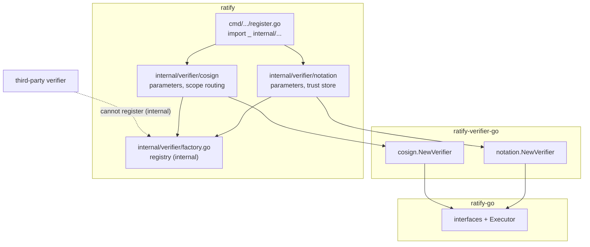
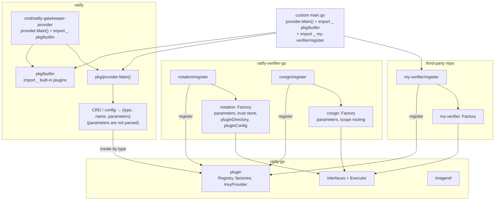

# Ratify v2 Plugin Framework

Author: Xinhe Li (@fseldow)

Related:
- [Ratify v2 Architecture Proposal – Plugin Framework](./Ratify%20v2%20Architecture%20Proposal.md#plugin-framework)
- [notaryproject/ratify#3131](https://github.com/notaryproject/ratify/issues/3131): verify signatures that need a Notation verification plugin (AWS Signer)

## Problem

The v2 architecture proposal defines a compile-time plugin framework:

> For customized plugins, user can create a new repo and implement the interfaces defined in the core library. The main application will automatically register the plugins during docker build time if the plugins are imported in the main application.

The implementation does not deliver that yet:

1. The plugin registries live in `ratify/internal/{verifier,store,policyenforcer,verifier/keyprovider}`. Go does not allow other modules to import `internal` packages, so a plugin in another repository cannot register itself.
2. The adapters that turn the `parameters` of a verifier into options (`internal/verifier/{notation,cosign}`), the Cosign scope routing, the Notation trust store and image reference normalization live in `ratify`, so every new verifier option needs a change in both `ratify-verifier-go` and `ratify`.
3. `cmd/ratify-gatekeeper-provider` depends on `internal/` packages, so a custom `main` package cannot reuse the provider.
4. The Notation verifier is created without a plugin manager, so signatures that require a Notation verification plugin, such as all AWS Signer signatures, fail with `plugin unsupported due to nil verifier.pluginManager`. In v1 the dynamic plugin download put the plugin binary next to Ratify; v2 removed that path without a replacement.

## Before



## After



### Responsibilities

| Component | Owns |
|---|---|
| `ratify-go` | Interfaces, `Executor`, the `plugin` registry and factory contracts, the shared `KeyProvider` interface, `imageref`. |
| `ratify-verifier-go/<verifier>` | The verifier implementation, its `Factory` and the schema of its `parameters`, and a `register` package that registers the factory to `plugin.Default`. |
| `ratify` | Kubernetes and Gatekeeper integration: CRDs, controllers, the external data server, configuration loading. It converts each verifier, store and policy enforcer entry into `{type, name, parameters}` and passes `parameters` through as raw JSON. `pkg/builtin` selects the plugins shipped in the official image; `pkg/provider` runs the provider. |

### Plugin contract

```go
// github.com/notaryproject/ratify-go/plugin
type VerifierFactory func(ctx context.Context, opts VerifierOptions) (ratify.Verifier, error)

type VerifierOptions struct {
	Name       string
	Parameters json.RawMessage // owned by the plugin
	Scopes     []string        // executor scopes, plugins may inherit them
	Registry   *Registry       // resolve nested plugins, e.g. key providers
}

func RegisterVerifier(typ string, factory VerifierFactory) // for init(), panics on error
```

`StoreFactory`, `PolicyEnforcerFactory` and `KeyProviderFactory` follow the same pattern. A `Registry` can also be created with `plugin.NewRegistry()` for tests or applications that do not want global state.

## Writing a custom verifier

```go
package register

import (
	"github.com/notaryproject/ratify-go/plugin"
	"example.com/my-verifier"
)

func init() {
	plugin.RegisterVerifier("my-verifier", myverifier.Factory)
}
```

## Building a provider with custom plugins

```go
package main

import (
	"github.com/notaryproject/ratify/v2/pkg/provider"

	_ "github.com/notaryproject/ratify/v2/pkg/builtin" // built-in plugins
	_ "example.com/my-verifier/register"                // custom plugin
)

func main() {
	provider.Main()
}
```

```dockerfile
FROM golang:1.27 AS builder
WORKDIR /src
COPY . .
RUN CGO_ENABLED=0 go build -o /out/ratify-gatekeeper-provider .

FROM gcr.io/distroless/static:nonroot
COPY --from=builder /out/ratify-gatekeeper-provider /app/ratify-gatekeeper-provider
ENTRYPOINT ["/app/ratify-gatekeeper-provider"]
```

Then set the provider image in the Helm chart.

## Notation verification plugins (AWS Signer)

Notation verification plugins are not Ratify plugins: they are executables that notation-go runs while it verifies a signature. The Notation verifier accepts two new parameters:

| Parameter | Description |
|---|---|
| `pluginDirectory` | Directory with Notation plugins, laid out like the Notation CLI: `<dir>/<plugin-name>/notation-<plugin-name>`. Without it, signatures that require a plugin fail. |
| `pluginConfig` | Key-value pairs passed to the plugin on every verification, the same as `notation verify --plugin-config`. For example `aws-region` for AWS Signer. |

The supported way to get the plugin binary into the pod is a custom image. Ratify does not publish an image with third-party plugins.

```dockerfile
FROM ghcr.io/notaryproject/ratify-gatekeeper-provider:<version>
COPY --chown=65532:65532 notation-com.amazonaws.signer.notation.plugin \
     /.ratify/plugins/com.amazonaws.signer.notation.plugin/notation-com.amazonaws.signer.notation.plugin
```

```yaml
verifiers:
  - name: notation-aws
    type: notation
    parameters:
      pluginDirectory: /.ratify/plugins
      pluginConfig:
        aws-region: us-west-2
      certificates:
        - type: signingAuthority
          files:
            - /etc/ratify/aws-signer-root.crt
```

## Migration

- Configuration (CRDs and config files) does not change.
- Third-party code that imported `ratify/v2/internal/...` was never supported.
- `ratify-verifier-go` module consumers keep `NewVerifier`; `Factory` and `register` are additive.

## Follow-ups

- Publish tagged releases of `ratify-go` and the `ratify-verifier-go` modules so that `ratify` does not depend on pseudo-versions.
- Consider moving key providers and registry credential providers out of `ratify` into their own modules so that non-Kubernetes consumers can reuse them.
- Add Helm values for extra volumes and init containers as an alternative to a custom image for Notation plugins.
- Update the AWS Signer quickstart on ratify.dev for v2.
